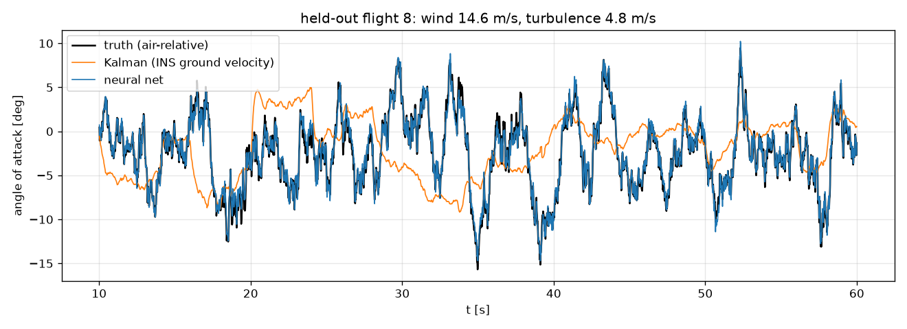

# A learned angle-of-attack estimator

A small neural network estimates the angle of attack (AoA, α) from the simulated
sensors only. We compare it with the Kalman filter (the 15-state INS) and with
the ground truth, first offline, then inside the fighter's fly-by-wire loop.

## The problem

The aircraft has no air-data sensor (no pitot tube, no AoA vane). The sensors
are the IMU, GPS, barometer and magnetometer.

Today, the fly-by-wire computes `α = atan2(w, u)` from the velocity. That is the
**ground** velocity, not the **air** velocity. In calm air the two are equal. In
wind or turbulence they are not, so this α is wrong exactly when the
stabilization needs it most: a gust changes the true α, and the ground-velocity α
does not see it.

## How the model was made

1. **Data** (`crates/fsim-sim/examples/aoa_nn.rs`, `dataset` command).
   - 60 flights of 60 s. Each flight has a random steady wind and random
     turbulence. Every 10th flight is calm air.
   - The Aerosonde flies random autopilot setpoints. The fighter flies a scripted
     pilot who holds random pitch and bank targets on fly-by-wire.
   - The simulated sensors and the INS run beside the flight. The fixed-wing flies
     on a small sphere, but the sensors and the INS assume flat ground. So each
     step we build a consistent flat local frame for them.
   - One row is written at 50 Hz. The first 10 s are dropped while the INS
     converges.
2. **Inputs (16)**: accelerometer (3), gyro (3), baro altitude, INS body
   velocity (3), INS roll and pitch, elevator, aileron, throttle, and the INS α.
   Wind, turbulence and the true α are never inputs.
3. **Target**: the true air-relative α, `atan2(w, u)` of `velocity − wind` in
   the body frame.
4. **Model** (`scripts/aoa_nn.py`): a scikit-learn MLP with 2 hidden layers of
   32 ReLU units, input standardization and early stopping. One flight in four
   is held out for testing. A test flight is never used in training.
5. **Export**: the script writes the weights to plain text. A forward pass of
   about 30 lines of Rust (`Mlp` in the example) runs it with no new dependency.

## Results

### Offline: estimation error on held-out flights (RMSE, degrees)

| Test set | Aerosonde, Kalman | Aerosonde, network | Fighter, Kalman | Fighter, network |
|---|---|---|---|---|
| All | 4.94 | **0.88** | 2.49 | **0.41** |
| Calm air | 1.08 | **0.73** | 0.87 | **0.29** |
| Wind, turbulence < 1.5 m/s | 4.96 | **0.85** | 2.20 | **0.33** |
| Wind, turbulence ≥ 1.5 m/s | 7.64 | **1.16** | 3.37 | **0.56** |



### Closed loop: the fighter's fly-by-wire flying on each α

There are 20 new flights (seeds not used in training), each 60 s, with wind and
turbulence. Every source flies the same flights, and only the α given to the
stability augmentation changes.

| α source | α error | Pitch-tracking error | Load-factor std | Max true α | Crashes |
|---|---|---|---|---|---|
| Default (true ground velocity) | 2.93° | 10.5° | 0.87 g | 13.3° | 0 |
| Kalman (INS) | 3.13° | 12.8° | 0.85 g | 14.3° | 0 |
| **Network** | **0.50°** | **7.4°** | **0.54 g** | **8.6°** | 0 |
| True air α (perfect sensor) | 0.26° | 7.5° | 0.55 g | 8.5° | 0 |

With the network, the fighter flies almost exactly like it has a perfect AoA
vane. The ride is about 40 % smoother, and the peak α is about 5° lower, so the
fighter stays further from the stall.

## Why it works

- The accelerometer measures the aerodynamic force. Normal force is lift, and
  lift is about `q̄·S·C_L(α)`. So the accelerometer "feels" the true air α,
  gusts included. The ground velocity cannot.
- The rest of the inputs give the network what it needs to invert that
  relation: speed and altitude (for `q̄`), elevator (its lift contribution),
  attitude and rates.
- The Kalman filter is not wrong. It estimates the ground velocity very well.
  But the ground velocity is the wrong quantity for α in wind.

## Limits

- **Same model for training and test.** The network learned this simulator's
  aerodynamic model. A real aircraft does not match its model this well, so real
  errors would be larger. Real use needs flight-test data or a trustworthy
  aerodynamic model.
- **Outside the training range.** The network can be badly wrong in conditions
  it has never seen (stall, spin, sensor faults, other masses or flight
  envelopes). A safe design keeps a monitor that compares it with the Kalman α
  and falls back if they disagree too much.
- **Certification.** A neural network in a flight-control loop is hard to
  certify. For the Ferrocene / safety-critical track, a learned estimator is a
  research tool, not a drop-in part.
- **The flat-frame bridge.** In calm air the INS α keeps an offset of about 1°.
  This comes from converting the sphere world into a flat frame for the
  sensors, not from the INS itself.

## Can this improve the autopilot and the fly-by-wire?

- **Fly-by-wire: yes, this is the result above.** Its stability augmentation
  feeds α back, so a better α directly gives a smoother, safer ride in
  turbulence.
- **Autopilot: probably, with a different target.** The Aerosonde autopilot does
  not use α. It holds airspeed, but it computes "airspeed" as `|velocity|`,
  which is the ground speed. In a headwind or a tailwind it holds the wrong speed,
  and a tailwind can bring it close to the stall. The same method can learn the
  true **airspeed** (or the wind vector) from the same sensors. Then the
  autopilot's speed hold and the fly-by-wire gain schedule (which also uses
  `|velocity|`) would see the real dynamic pressure. This has not been tested
  yet.

## Reproduce

```sh
cargo run -p fsim-sim --release --example aoa_nn -- dataset fighter fighter.csv 60
uv run scripts/aoa_nn.py fighter.csv          # table, fighter.png, fighter.weights.txt
cargo run -p fsim-sim --release --example aoa_nn -- loop fighter.weights.txt 20
```

Use `dataset aerosonde` for the Aerosonde offline numbers.
